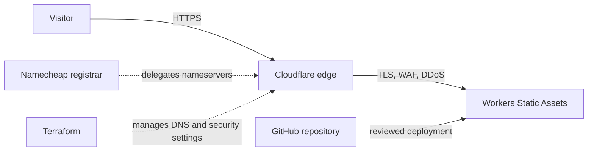
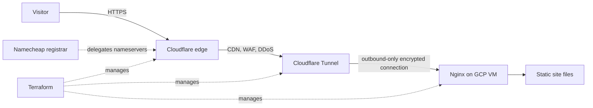

# Cloudflare Edge Security Showcase

A small public website used to compare two valid deployment patterns: hosting static assets directly on Cloudflare, or hosting an origin on Google Cloud and reaching it through Cloudflare Tunnel. The application stays intentionally simple so the repository can focus on cost, DNS, TLS, CDN, DDoS protection, origin isolation, and reproducible infrastructure.

> *The website is deliberately simple. The threat model has enough hobbies already.*

## Recommendation: two tracks, one sensible cloud bill

Use a two-track design:

- **Default live site — Cloudflare Workers Static Assets.** This is the best fit for a static portfolio: static asset requests and storage are free, there is no server to patch, and there is no separate origin IP to expose. Cloudflare recommends Workers Static Assets rather than Pages for new projects because current development is focused on Workers. Sometimes the best server is the one that does not need a 02:00 patch window.
- **Advanced cloud-security lab — GCP Compute Engine plus Cloudflare Tunnel.** Keep the existing Terraform implementation as an optional demonstration of VPC networking, deny-by-default ingress, NAT, VM hardening, outbound-only tunnels, and infrastructure lifecycle management. It is more infrastructure than a brochure site needs, which is precisely why it makes a useful lab.

Use **Terraform for DNS, WAF, TLS settings, and the GCP lab**. Use a static-asset deployment tool such as Wrangler for the Cloudflare-hosted files. Keep only unavoidable ownership steps manual: purchasing the domain, creating the initial accounts/project, and changing registrar nameservers.

Namecheap remains the registrar in both tracks, while Cloudflare provides authoritative DNS and edge security. Namecheap documents how to point a domain at [Cloudflare nameservers](https://www.namecheap.com/support/knowledgebase/article.aspx/9607/2210/how-to-set-up-dns-records-for-your-domain-in-a-cloudflare-account/).

### Pick your cloud adventure

| Scenario | Recommended option | Reason |
| --- | --- | --- |
| Personal portfolio, résumé, documentation, or brochure site | Cloudflare static assets | Lowest cost and operational effort; no origin server is required. |
| Static site with a small contact form or lightweight API later | Cloudflare static assets plus a Worker | Keep static delivery free and invoke code only for the dynamic routes. |
| Cloud/security engineering portfolio demonstration | GCP plus Cloudflare Tunnel | Shows cloud networking, IAM, VM hardening, private-origin design, and Terraform dependencies. |
| Existing application that requires a container, daemon, or OS packages | GCP plus Cloudflare Tunnel | The workload needs a general-purpose runtime rather than static hosting. |
| Short-lived training lab | GCP plus Cloudflare Tunnel, deployed on demand | Demonstrates the architecture without paying to keep it running continuously. |

The detailed comparison and example scenarios are in [Deployment options](docs/deployment-options.md).

AWS plus Route 53 would also be a good portfolio combination, but it adds two DNS systems when Cloudflare must be authoritative for a normal full-zone setup. If Route 53 is used only as the registrar, AWS recommends changing its nameservers to the other DNS provider and optionally deleting the unused hosted zone to avoid charges. See the [Route 53 nameserver guide](https://docs.aws.amazon.com/Route53/latest/DeveloperGuide/domain-register-other-dns-service.html).

## Architecture

### Option A — Cloudflare-hosted static site



Cloudflare is both the edge and the origin for this option. Static asset requests are free and unlimited, and there is no additional asset-storage charge. There is no VM, NAT gateway, origin certificate, Tunnel token, or public origin address to manage.

### Option B — GCP origin through Cloudflare Tunnel



The GCP track is the implemented infrastructure lab. Its secure default creates a private VM and Cloud NAT. Cloud NAT has a small hourly and data-processing charge; see [Google Cloud NAT pricing](https://cloud.google.com/nat/pricing). For a lower-cost lab, set `enable_cloud_nat = false` and `assign_external_ip = true`. That mode gives the VM an outbound-capable external IP, but GCP still has an explicit deny-all ingress rule, the address is never published in DNS, and visitor traffic uses Tunnel.

An `e2-micro` VM is included in Google Cloud's Free Tier in eligible US regions, subject to the current [Free Program limits](https://docs.cloud.google.com/free/docs/free-cloud-features). The VM alone being Free Tier eligible does not make the entire GCP design free.

## What the Cloudflare Free plan contributes

| Control | Included approach | Important boundary |
| --- | --- | --- |
| Browser TLS | Universal SSL issues and renews an edge certificate for activated domains. | Keep DNS records proxied. Free certificates have the plan's documented compatibility limits. |
| DDoS | Standard, unmetered L3-L7 protection is automatic on all plans. | Advanced tuning and specialized protections can require paid products. |
| WAF | The Free Managed Ruleset is deployed by default, plus this project adds one custom rule that blocks non-read methods on the static site. | Revisit the rule before adding forms or APIs. |
| CDN | Static assets are served from Cloudflare directly or cached in front of the GCP origin. | HTML is deliberately revalidated so content updates appear quickly. |
| Origin isolation | Cloudflare hosting eliminates the external origin. The GCP track uses Tunnel and a private VM. | The GCP track stores a sensitive Tunnel token in Terraform state. |
| DNS hygiene | The DNS records depend on the Tunnel resource, so Terraform removes them before the Tunnel. Cloudflare Security Insights can flag dangling A, AAAA, and CNAME records. | Detection is periodic and heuristic, not a substitute for disciplined decommissioning. |
| DNSSEC | Optional Terraform resource; enable after delegation is stable and publish the returned DS record at the registrar. | DNSSEC is not complete until the registrar has the DS record. |

Primary feature references: [Workers Static Assets](https://developers.cloudflare.com/workers/static-assets/), [static asset billing](https://developers.cloudflare.com/workers/static-assets/billing-and-limitations/), [Universal SSL](https://developers.cloudflare.com/ssl/edge-certificates/universal-ssl/), [DDoS availability](https://developers.cloudflare.com/ddos-protection/), [Free WAF rules](https://developers.cloudflare.com/waf/get-started/), and [Security Insights](https://developers.cloudflare.com/security/security-insights/).

## Repository layout (nothing up our sleeves)

```text
.
|-- .editorconfig
|-- .gitattributes
|-- .gitignore
|-- .github/
|   |-- dependabot.yml
|   `-- workflows/validate.yml
|-- AGENTS.md
|-- README.md
|-- SECURITY.md
|-- docs/
|   `-- deployment-options.md
|-- site/
|   |-- Dockerfile
|   |-- index.html
|   |-- nginx.conf
|   |-- script.js
|   `-- styles.css
`-- infra/terraform/
    |-- cloudflare.tf
    |-- main.tf
    |-- outputs.tf
    |-- providers.tf
    |-- startup.sh.tftpl
    |-- terraform.tfvars.example
    |-- variables.tf
    `-- versions.tf
```

The root [`.gitignore`](.gitignore) keeps Terraform state and plans, populated variable files, local environment files, Cloudflare/Wrangler state, package directories, private keys, and exported cloud credentials out of commits. It is a guardrail, not a vault: real secrets still belong in GitHub Environment secrets or a dedicated secret manager. Git cannot leak what Git never receives—an oddly effective security control.

## Bootstrap and deploy the GCP lab

The steps below deploy Option B, the GCP plus Tunnel lab currently implemented in Terraform. Option A is the recommended always-on site; its deployment configuration can be added without removing this lab.

### 1. Create the accounts and domain

1. Create a GCP project with billing enabled.
2. Purchase a domain from Namecheap. Domain purchases are intentionally not automated because they spend money, create ownership obligations, and require personal registration details.
3. Add the domain to Cloudflare on the Free plan.
4. At Namecheap, select **CustomDNS** and enter the two nameservers Cloudflare assigned. Recreate any existing mail or verification records in Cloudflare before switching.
5. Wait until Cloudflare reports the zone as active.

### 2. Create least-privilege credentials

Create a Cloudflare API token limited to the target account and zone with:

- Account: Cloudflare Tunnel Edit
- Zone: DNS Edit
- Zone: Zone Settings Edit
- Zone: DNSSEC Edit, only if `enable_dnssec = true`

Authenticate Google Cloud with Application Default Credentials:

```sh
gcloud auth application-default login
gcloud config set project YOUR_GCP_PROJECT_ID
```

Export the Cloudflare token in your shell. Do not put it in a `.tfvars` file:

```sh
export CLOUDFLARE_API_TOKEN='replace-me'
```

PowerShell equivalent:

```powershell
$env:CLOUDFLARE_API_TOKEN = 'replace-me'
```

For GitHub Actions, put sensitive values in a protected GitHub **Environment secret**, not in the repository and not in a GitHub variable. Use variables only for non-secret configuration such as region, project ID, account ID, zone ID, domain, and role name. GitHub documents repository, environment, and organization secrets in [Using secrets in GitHub Actions](https://docs.github.com/en/actions/how-tos/write-workflows/choose-what-workflows-do/use-secrets).

Prefer GitHub OpenID Connect for GCP, AWS, or Azure deployments. OIDC exchanges the workflow identity for a short-lived cloud credential instead of storing a long-lived cloud access key in GitHub. See GitHub's [deployment security hardening guidance](https://docs.github.com/en/actions/how-tos/secure-your-work/security-harden-deployments).

Never store any of the following in tracked files, Terraform variable defaults, workflow YAML, issues, pull requests, logs, or command-line arguments:

- AWS access keys, secret keys, session tokens, account passwords, or private keys.
- GCP service-account JSON keys, OAuth secrets, refresh tokens, or private keys.
- Azure client secrets, certificates, storage keys, SAS tokens, or publish profiles.
- Cloudflare API tokens, global API keys, Origin CA private keys, or Tunnel tokens.
- GitHub personal access tokens, deploy private keys, application private keys, or webhook secrets.
- Database passwords, connection strings, signing keys, TLS/SSH private keys, registrar recovery codes, MFA seeds, or backup codes.
- Terraform state and saved plan files, because providers can place sensitive values inside them even when CLI output is marked sensitive.

AWS account IDs, Azure subscription/tenant IDs, GCP project IDs, Cloudflare account/zone IDs, and cloud role ARNs are identifiers rather than credentials. They may be stored as non-secret variables if public disclosure is acceptable, but keeping infrastructure metadata private is a reasonable owner choice.

For a public GitHub repository, GitHub secret scanning runs automatically for free. Keep push protection enabled and treat it as a backstop rather than permission to handle secrets casually. Review the current [secret-scanning scope and limitations](https://docs.github.com/en/code-security/reference/secret-security/secret-scanning-scope).

All third-party GitHub Actions in this repository are pinned to immutable, full-length commit SHAs, with the corresponding release tag retained in a comment. GitHub identifies full-length commit pinning as the only immutable way to reference an Action. In the repository's **Settings → Actions → General**, also enable **Require actions to be pinned to a full-length commit SHA**. Dependabot is configured to propose reviewed updates to these pins.

Runtime container images use a readable release tag plus an immutable `sha256` digest. The tag explains what should be running; the digest guarantees what actually runs. Update both values together after reviewing the upstream release notes.

If a secret is committed, revoke or rotate it first, then remove it from the current tree and Git history. Deleting the file alone does not invalidate copies already fetched or cached.

### 3. Configure and apply Terraform

```sh
cp infra/terraform/terraform.tfvars.example infra/terraform/terraform.tfvars
# Edit terraform.tfvars with the real project, account, zone, and domain values.

terraform -chdir=infra/terraform init
terraform -chdir=infra/terraform fmt -check -recursive
terraform -chdir=infra/terraform validate
terraform -chdir=infra/terraform plan -out=tfplan
terraform -chdir=infra/terraform apply tfplan
```

The VM startup script embeds the current `site/` files, starts Nginx on the VM's loopback interface, and starts `cloudflared`. Changing a site file changes the startup script and intentionally replaces the small demo VM so the running content cannot drift from Git.

The Cloudflare Tunnel token is sensitive and is stored in Terraform state. Use an encrypted remote backend with restricted access before treating this as production infrastructure. Never commit state or saved plan files.

### 4. Verify

After apply, check:

```sh
curl -I https://YOUR_DOMAIN
curl -I http://YOUR_DOMAIN
```

Expected results:

- HTTPS returns `200` and security headers.
- HTTP redirects to HTTPS at Cloudflare.
- `dig YOUR_DOMAIN` returns Cloudflare anycast addresses, not an origin address.
- GCP shows no inbound allow rule for the VM.
- The Cloudflare Tunnel status is healthy.
- A non-read request such as `curl -X POST -I https://YOUR_DOMAIN` is blocked by the custom WAF rule when enabled.

## Optional paid upgrades

Add paid features only when the portfolio story needs them:

- **Cloudflare Pro** for the broader managed WAF ruleset and additional bot controls.
- **Argo Smart Routing** for latency and reliability optimization on dynamic traffic.
- **Cache Reserve** for persistent cache storage and fewer origin fetches.
- **Load Balancing** plus a second Tunnel connector/VM for origin failover.
- **Advanced Certificate Manager** for deeper hostname coverage or certificate controls beyond Universal SSL.

Plan entitlements change over time, so verify the current Cloudflare plan matrix before enabling an add-on.

## Safe teardown

Run and review a destroy plan before decommissioning:

```sh
terraform -chdir=infra/terraform plan -destroy
terraform -chdir=infra/terraform destroy
```

Because the proxied DNS records reference the Tunnel ID, Terraform orders their removal before Tunnel deletion. Confirm the records are gone in Cloudflare Security Insights afterward. Keep the domain registered unless you intentionally want it to expire, and remove the DS record at the registrar before disabling DNSSEC.
